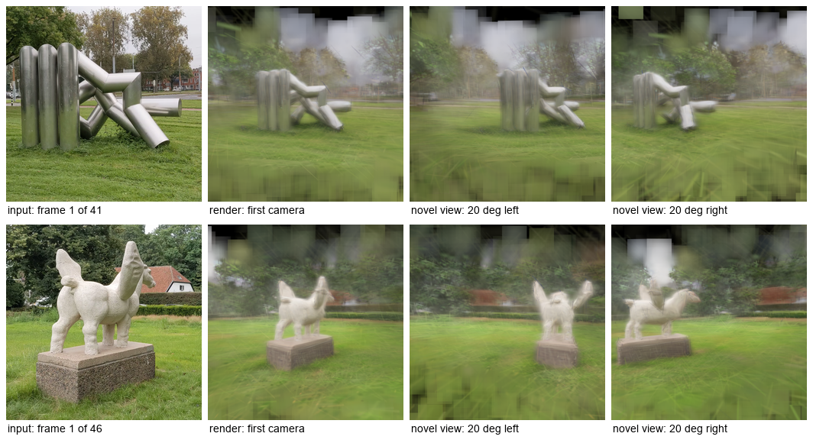
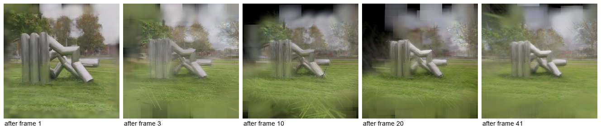

# S2Tok for ComfyUI

> **Non-commercial use only.** S2Tok's code and model weights are licensed under
> [CC BY-NC 4.0](https://creativecommons.org/licenses/by-nc/4.0/) (and so are the models and data they derive from). This node pack
> runs that code and those weights, so you may use it only for non-commercial purposes. See [Licenses](#licenses).

Reconstruct a static scene as **3D Gaussians from the frames of a video**, one frame at a time and without camera poses, in ComfyUI
with the official **S2Tok** model ([Applied-Intuition-Open-Source/S2Tok](https://github.com/Applied-Intuition-Open-Source/S2Tok),
paper [arXiv:2610.08978](https://arxiv.org/abs/2610.08978), *Streaming 3D Gaussian Reconstruction with Persistent Spatial Tokens*).
The result is ComfyUI's own `SPLAT` type, so the core nodes render it, save it as a standard 3DGS `.ply` or preview it. Everything
runs inside the ComfyUI process; the nodes never download anything.

> **Unofficial.** Not affiliated with or endorsed by the S2Tok authors (Applied Intuition), ETH Zurich (ZipSplat), ByteDance (Depth
> Anything 3), Meta (DINOv2) or Comfy Org.
>
> 日本語の概要は [README.ja.md](README.ja.md) にあります。





<sub>Renders of reconstructions of two CC BY-SA 4.0 videos by FakirNL on Wikimedia Commons; sources in
[docs/images/README.md](docs/images/README.md).</sub>

## What it does

| Node | Purpose |
| --- | --- |
| **S2Tok Loader** | Picks the checkpoint from `models/s2tok`, the device and a keep-loaded switch |
| **S2Tok Reconstruct** | `IMAGE` frames in order → `SPLAT` (the scene after the last frame, or one per frame) and a JSON report |
| **S2Tok Unload** | Frees the resident model (GPU and RAM) |

Core nodes do the rest: **Load Video** + **Get Video Components** give the frames; **Create 3D File (from Splat)** + **Save Splat**
write the `.ply`; **Render Splat** with **Create Camera Info** renders views; **Create Video** + **Save Video** turn the per-frame
reconstructions into a video.

## How far it was checked

Windows 11, RTX 5090 (32 GB), ComfyUI v0.38.0, torch 2.14.1 (details and raw numbers in [docs/VERIFICATION.md](docs/VERIFICATION.md)):

- **Byte-identical to the official code.** For two video scenes (41 and 46 frames), the `.ply` that ComfyUI's Save Splat writes
  through the real queue (Load Video → S2Tok Reconstruct → Create 3D File → Save Splat) is byte for byte the `scene.ply` that the
  official `demo.py` writes from the same frames; run in-process, the pack also reproduces `demo.py`'s `frames.json` byte for byte.
- **bf16 on Windows.** The official `--precision bf16` fails on the official Windows PyTorch wheels (no FlashAttention kernel). The pack
  carries the one-statement fix proposed upstream ([S2Tok PR #1](https://github.com/Applied-Intuition-Open-Source/S2Tok/pull/1));
  its bf16 output equals the patched official code byte for byte, and fp32 is unaffected.
- Real jobs: fp32 / bf16, CPU, 190-frame sequence, every-frame output, interrupt, unload and keep-loaded off.
- **CI** (GitHub Actions; Ubuntu and Windows; Python 3.10 and 3.12): CPU tests with a tiny random S2Tok in the official checkpoint
  format, the preprocessing compared with the official `demo.py` function, the vendored code compared byte for byte with the pinned
  upstream commit, and a real ComfyUI queue on the CPU. CI does not download the weights (6.9 GB).

**Not checked:** Linux or macOS with a GPU, AMD / Apple GPUs, other ComfyUI versions, reconstruction quality against the paper's
benchmarks (the pack reproduces the official outputs; it does not re-evaluate the model).

## Install

1. ComfyUI with the V3 node API and the splat nodes (**v0.38.0** was used), Python 3.10+, an NVIDIA GPU with about 8 GB of free VRAM
   (the CPU works, about 12 times slower).
2. Put this folder into `ComfyUI/custom_nodes/` and install its requirements into ComfyUI's Python (`einops`, `numpy`, `pillow`;
   ComfyUI already has them):

   ```
   python -m pip install -r custom_nodes/ComfyUI-S2Tok/requirements.txt
   ```
3. **If your use is non-commercial**, download the checkpoint (6.9 GB, CC BY-NC 4.0) into `models/s2tok/`:

   ```
   python custom_nodes/ComfyUI-S2Tok/tools/download_model.py --models-dir ComfyUI/models/s2tok
   ```

   This fetches `s2tok_252.pt` from `AppliedIntuitionResearch/S2Tok` at the revision this pack was verified with and checks its SHA-256
   (`--verify-only` checks an existing file).
4. Restart ComfyUI and load a workflow from `workflows/gui/` (or `workflows/api/`). Their Load Video node points at `example.mp4`:
   choose your own video there.

## Using the nodes

- **Input.** A video that moves through or around a *static* scene. Frames are center-cropped to a square and resized to 252 x 252
  (the training resolution), exactly as `demo.py` does. `frame_interval` uses every n-th frame (the workflows use 4); the model was
  trained on 12 to 24-frame sequences and the official README mentions 96-frame runs. `max_frames` stops early (0 = all).
- **Long videos.** Load Video + Get Video Components decode *every* frame at full size (a 1080p frame is about 25 MB as an IMAGE), so
  for long clips sample first, e.g. with **Video Frame Sample** (uniform) or **Video Slice** before Get Video Components. In ComfyUI
  v0.38 Video Frame Sample fails on WebM / MKV files because of an off-by-one in the frame count
  ([fix proposed: ComfyUI PR #17154](https://github.com/Comfy-Org/ComfyUI/pull/17154)); MP4 works.
- **Memory.** The scene memory holds at most 4000 tokens (128,000 Gaussians); once it is full, no more patches are admitted
  (`memory_full` in the report). A 190-frame walkthrough sampled every 40 frames used 3558.
- **Output.** `splat` holds the Gaussians in the camera frame of the first frame (x right, y down, z forward), which is also the
  convention of ComfyUI's splat nodes, up to an unknown global scale. To look through the first camera, give Render Splat a
  Create Camera Info in `quaternion` mode at position 0, 0, 0 with quaternion 0, 0, 0, 1 (S2Tok does not estimate the field of
  view; the workflows use 60°). `every_frame` outputs the reconstruction after every frame as a batch (for progress videos).
- **precision.** `fp32` is the official default. `bf16` took 3.3 s instead of 5.5 s for 41 frames and its scene differs slightly
  (0.4 to 0.7 % fewer Gaussians in our two scenes); it needs CUDA.
- The **report** has the frame and Gaussian counts, the memory size, time, peak VRAM and, per frame, the admitted patches and the
  predicted log scene scale.

## Measured on this setup

RTX 5090, Intel Core Ultra 9 285K, 64 GB RAM, Windows 11, torch 2.14.1+cu130, fp32 unless noted:

| run | time | peak VRAM (allocated) |
| --- | --- | --- |
| loading the checkpoint | 3.5 s (file in the OS cache) | — |
| 41 frames (every 4th of a 5.4 s 1080p clip) | 5.5 to 5.9 s; bf16 3.3 s | 6.9 GiB |
| 46 frames | 6.4 s | 6.9 GiB |
| 190 frames (every 40th of a 126 s walkthrough) | 42.9 s | 7.1 GiB |
| 10 frames on the CPU | 14.2 s (GPU: 1.2 s) | — |

The time per frame grows with the scene memory. A whole queue job with Load Video takes a few seconds more (decoding).

## Notes and limits

- S2Tok reconstructs **static** scenes at 252 x 252 input resolution; moving objects, very fast camera motion and scenes seen from far
  outside the input path give blurry or blocky Gaussians (visible in the novel views above).
- The vendored code is the official package at commit `96e8f58`; only `s2tok/model.py` carries the bf16 kernel fallback above
  ([UPSTREAM.md](s2tok_comfy/vendor/UPSTREAM.md)). The test suite checks every byte against the upstream commit.
- Videos are decoded by ComfyUI (PyAV), not OpenCV as in `demo.py`; different decoders can give slightly different pixels. The
  byte-identical comparison above used the frames ComfyUI decodes, given to `demo.py` as an image folder.

## Licenses

- **S2Tok code** (`s2tok_comfy/vendor/`): CC BY-NC 4.0, Copyright 2026 The S2Tok Authors; **non-commercial use only**. Parts are derived
  from ZipSplat, DINOv2, Depth Anything 3 and timm (Apache-2.0); see the upstream `NOTICE` and `THIRD_PARTY_LICENSES` in that folder.
- **Model weights** (not included; `tools/download_model.py` fetches them when you run it): CC BY-NC 4.0, **non-commercial use only**;
  fine-tuned from ZipSplat (CC BY-NC 4.0), initialised from DA3-Giant (CC BY-NC 4.0), trained on DL3DV-10K (non-commercial terms) and
  RealEstate10K. Their terms apply too.
- **The rest of this repository** (the ComfyUI integration, tools, tests, workflows): MIT ([LICENSE](LICENSE), which states this scope).
  Using the nodes still runs the CC BY-NC code and weights.
- `docs/images`: CC BY-SA 4.0 (renders of CC BY-SA 4.0 videos; [sources](docs/images/README.md)).
- ComfyUI (GPL-3.0) hosts the nodes; PyTorch, NumPy, Pillow and einops keep their own licenses.

This pack is not listed in the Comfy Registry.

## Development

```
pip install pytest ruff                                   # plus ComfyUI's requirements
S2TOK_COMFYUI_DIR=... S2TOK_UPSTREAM_DIR=... python -m pytest tests
python scripts/ci_queue_check.py --comfyui <ComfyUI>       # real queue on the CPU, tiny model
python scripts/run_jobs.py --checkpoint s2tok_252.pt --out <dir> <frames dir> ...    # writes scene.ply + frames.json like demo.py
python scripts/compare_ply.py a.ply b.ply
```

`scripts/vendor_sync.py --upstream <checkout>` rebuilds the vendored folder and its manifest (`--check` only compares).

## Citation

If you use S2Tok, please cite the authors (BibTeX in the upstream README, arXiv:2610.08978).
